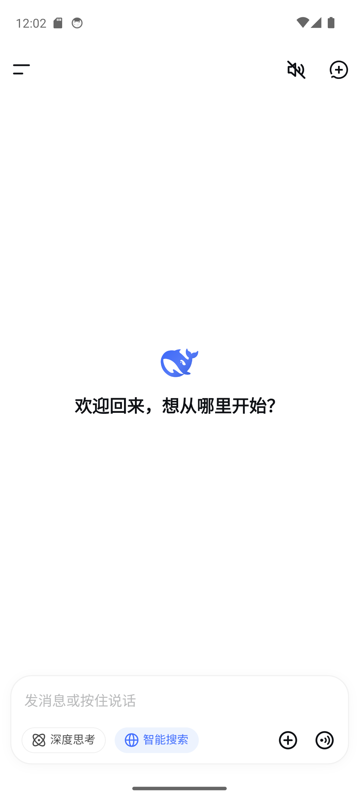
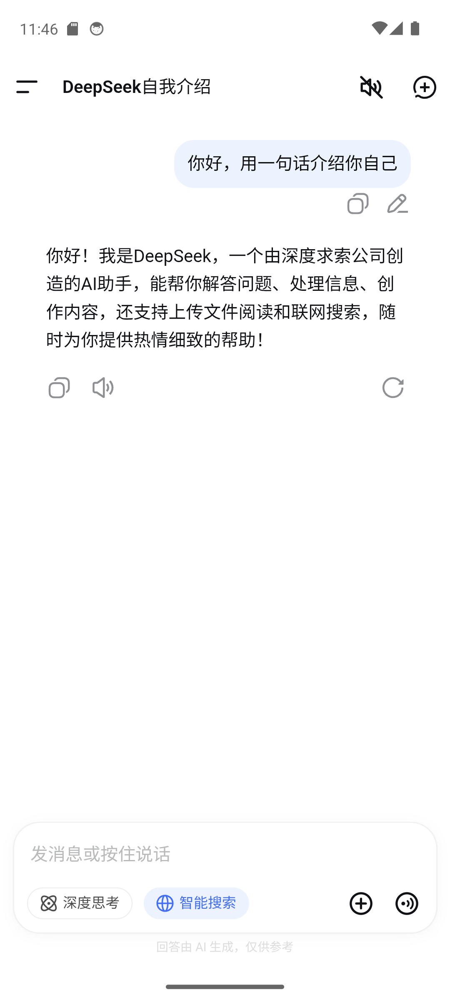
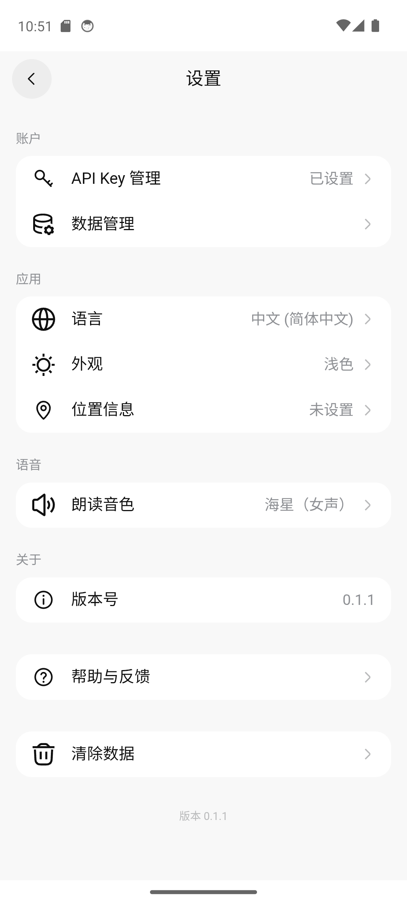

# DeepChat

**DeepSeek 的安卓客户端（非官方）** — 把 [deepseek-ai/chat-demo](https://github.com/deepseek-ai/chat-demo)
用 Capacitor 6 包成 APK，界面与交互对齐官方 Android 客户端 v2.8，能力上保留「填 API Key 即用」的方式，
并额外支持多家 OpenAI 兼容服务商。

<p align="center">
  
  
  
</p>

> **免责声明**
> 本项目是**非官方**客户端，与杭州深度求索（DeepSeek）没有任何关联，也未获其背书。
> 应用名为 DeepChat；启动图标里的鲸鱼取自官方 App 图标（去除底色转成透明 PNG），
> 仅用于表示「这是一个连接 DeepSeek API 的客户端」。
> 接口费用由你自己的 API Key 承担；请遵守 DeepSeek 的服务条款与当地法律法规。
> 若官方提出异议，本项目会立即更名或停止分发。

---

## 它是什么

- **一个纯前端 App**：没有后端、没有账号体系、不采集数据。对话记录、API Key 全部存在手机本地的 IndexedDB / localStorage。
- **用你自己的 API Key**：首次打开会引导填写，之后所有请求直连 `https://api.deepseek.com`。
- **对齐了官方手机版的界面**：首页空态、输入卡片、抽屉、设置页、消息气泡与操作行，尺寸/颜色/字号按真机截图逐项量过。

## 支持多家 API（自带地址预设，只填 Key）

设置 → 账户 → API Key 管理 → 添加 API Key，选服务商后**只需要填 Key**：

| 服务商 | 协议 | 默认模型 |
|---|---|---|
| DeepSeek 官方 | Anthropic 兼容 | 内置（附件/联网/语音全可用） |
| 智谱 GLM / GLM 国际 | OpenAI 兼容 | glm-4.6 |
| 阿里云百炼（通义千问）/ 国际 | OpenAI 兼容 | qwen3-max |
| 月之暗面 Kimi / 国际 | OpenAI 兼容 | kimi-k2-0905-preview |
| 硅基流动 SiliconFlow | OpenAI 兼容 | deepseek-ai/DeepSeek-V3 |
| 火山方舟（豆包） | OpenAI 兼容 | doubao-seed-1-6 |
| 百度千帆（文心） | OpenAI 兼容 | ernie-4.5-turbo-128k |
| 腾讯混元 | OpenAI 兼容 | hunyuan-turbos-latest |
| MiniMax / 国际 | OpenAI 兼容 | MiniMax-M2 |
| 阶跃星辰 / 讯飞星火 / 商汤日日新 / 百川 | OpenAI 兼容 | 见预设 |
| OpenAI / Anthropic / Google Gemini / xAI | OpenAI 兼容 | gpt-4.1 / claude-sonnet-4-5 / gemini-2.5-pro / grok-4 |
| Mistral / Groq / Together / Fireworks / DeepInfra / Cerebras / SambaNova / Novita | OpenAI 兼容 | 见预设 |
| OpenRouter / Perplexity / Cohere / OpenCode Zen | OpenAI 兼容 | 见预设 |
| Ollama / LM Studio（本机） | OpenAI 兼容 | 见预设 |
| 自定义 | OpenAI 兼容 | 手填 |

OpenAI 兼容地址都在开发机实测过 `/chat/completions` 有响应（401/403/400 表示端点存在），模型名可随时改。
OpenAI 兼容配置下**附件、语音输入、朗读不可用**（依赖 DeepSeek 的 Files API 与 TTS/ASR）。

可以保存多条配置，点一行即切换。

## 申请官方 API Key

首次打开没有 Key 时会直接进入「申请官方 API Key」指引：四步说明 + 三个直达按钮
（开放平台 / API Keys 页面 / 充值页面，用应用内浏览器打开），拿到 Key 后一键跳到填写表单。
整个过程不用离开 App，也不需要输入任何账号密码到本应用。

## 界面细节

- 输入框上方右侧的「上下文圆环」显示额度占用（仿 DSH），点击可查看/压缩；背景透明，不遮挡聊天区
- 设置里的「字体大小」照官方：顶部预览 + 「跟随系统」开关 + A—A 七档滑块，实时作用于聊天正文
- 「个性化」= 思考内容自动折叠（官方同款）+ 头像/昵称（本地）+ 位置信息
- 消息操作行：复制 / 朗读 / 分享 / 重新生成；分享走系统分享面板
- 底部「退出登录」清除本机 API Key 配置（对话记录保留）

## 返回与手势

- 设置里的二级页（数据管理、外观、API Key 管理等）按系统返回键只回上一层：表单 → 列表 → 设置根页 → 关闭
- 在屏幕左侧约 1/3 区域内向右滑可打开对话列表；抽屉打开时向左滑关闭

## 上下文压缩

输入框上方右侧是一个上下文圆环；**用量达到 80% 后才允许压缩**（低于 80% 圆环面板里会提示「80% 后可压缩」），接近上限（默认 80%）时变成醒目的黄色提示。点「压缩上下文」会先弹出**风险确认**：

- 原话、语气和情绪细节会消失，之后模型只看到一段概括
- 摘要由模型生成，可能漏掉或记错人名、时间、约定的小事
- 压缩只是把旧消息移出上下文，**原始记录仍完整保存在本机对话里**，可以随时回看
- 把对话当日记的话，压缩后只剩梗概

弹窗里提供「先导出备份（ZIP）」——导出文件保留完整原文，可随时重新导入。

压缩**不删除任何原始消息**：旧对话仍留在会话里可以往上翻，只是不再发给模型。所有压缩过的对话都能在
「设置 → 数据管理 → 已压缩的对话」里集中管理：查看摘要、打开原文、或「恢复完整上下文」把压缩撤销。压缩完成后，输入框上方会出现
「上下文已压缩（原始记录仍保留）」/「查看上下文摘要」，点开能看到模型生成的摘要（含压缩时间与覆盖条数），
还可以直接编辑摘要。确认后才执行压缩：
保留最近约 16% 的对话，把更早的压成结构化摘要（沿用 DeepSeek Harness 的 compaction 提示词与
`<compacted-summary>` 检查点格式）。每个 API 配置可以填自己的上下文窗口大小。

## 从 DeepSeek 导入历史

官方 App「设置 → 导出数据」会生成一个 7 天有效的下载链接；本 App「设置 → 数据管理 → 从 DeepSeek 导入」
粘进去就能直接下载并导入（也可以下载 ZIP 后用「导入历史对话」选本地文件）。

## 与官方 App 的差异

| 能力 | 官方 App | 本项目 |
|---|---|---|
| 登录 | 手机号 / 微信等 | 不需要，填 API Key |
| 模型 | 官方托管 | 你自己 Key 可用的模型 |
| 语音朗读 | 官方 TTS | DeepSeek TTS 接口（音色 stella / tide） |
| 联网搜索 | 服务端内建 | 走 API 的 `web_search` 工具 |
| 多设备同步 | 有 | 无，只在本地（可导出 ZIP 备份） |

## 安装

仓库根目录的 `deepchat.apk`（release 签名版）或 `deepchat-debug.apk`（debug 版），
允许「安装未知来源应用」后安装。

要求：Android 6.0（API 23）及以上。

## 构建

```bash
# 1) 依赖（国内网络加镜像）
cd chat-demo && pnpm install --registry=https://registry.npmmirror.com

# 2) Web 资源 + 同步到原生工程
pnpm build
npx cap sync android

# 3) 打 APK（必须 JDK 17，系统默认的 JDK 21+ 会让 AGP 8.2.1 失败）
export JAVA_HOME=/opt/homebrew/opt/openjdk@17/libexec/openjdk.jdk/Contents/Home   # macOS Homebrew
cd android && ./gradlew assembleDebug
# 产物：android/app/build/outputs/apk/debug/app-debug.apk
```

装到模拟器/真机：

```bash
adb install -r android/app/build/outputs/apk/debug/app-debug.apk
adb shell am start -n ai.deepseek.demo.shell/.MainActivity
```

## 构建 release

```bash
cd android
./gradlew assembleRelease     # 用 android/keystore.properties 里的密钥签名
# 产物：android/app/build/outputs/apk/release/app-release.apk
```

密钥文件 `android/app/deepseek-demo.jks` 与 `android/keystore.properties` 不入库；换机器时自己生成一份即可。

## 已知限制

- OpenAI 兼容配置下，附件上传、语音输入、朗读都不可用（依赖 DeepSeek 的 Files API 与 TTS/ASR）。
- 助手消息的操作行只有 复制 / 朗读 / 重新生成；官方的 赞 / 踩 / 分享 需要服务端接口，未实现。
- 「从 DeepSeek 导入」走 WebView 的 fetch，若官方下载域不带 CORS 头会失败，此时改用本地 ZIP 导入。

## 许可

上游 `chat-demo` 为 MIT 许可，见 `chat-demo/LICENSE`。本仓库在其之上新增的安卓封装与 UI 调整同样以 MIT 发布。

## 仓库结构

```
.
├── README.md              # 本文件
├── HANDOFF.md             # 开发过程记录（每轮做了什么、踩了什么坑）
├── UI-AUDIT.md            # 上游 Web 端移动端 UI 审计
├── screenshots/           # 真机截图
├── handoff/agent-tasks/   # 并行任务的派工说明
└── chat-demo/             # 上游仓库 fork：Web 源码 + android/ Capacitor 工程
```

`reference/`（官方 APK 与官方截图取证材料）与打包产物不入库；APK 走 [Releases](../../releases) 分发。

## 更新

App 内「设置 → 检查更新」读的是仓库根目录的 **`update.json`**（走 raw.githubusercontent，避开 GitHub API 的
60 次/小时限制），发现新版本可以直接下载 APK 并拉起系统安装器；API 只在清单缺失时兜底。

发版一条命令：

```bash
scripts/release.sh 1.0.1 "这次改了什么"
```

它会改版本号（package.json + build.gradle 的 versionCode/versionName）→ 打包 → 刷新 `update.json`
→ 提交推送 → `gh release create` 上传 APK。
