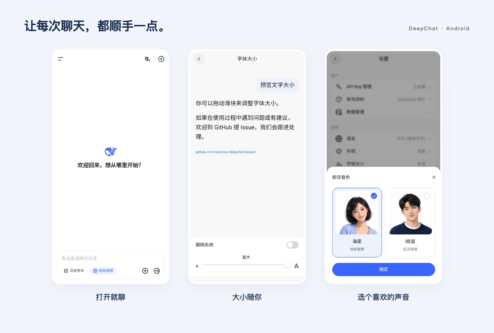

<p align="center">
  
</p>

<p align="center">
  一款使用自有 API Key 的 Android 聊天应用。熟悉的移动端交互，多服务商切换，聊天记录保存在本机。
</p>

<p align="center">
  <a href="https://github.com/leezzou/deepchat/releases/latest"></a>
  <a href="https://gitee.com/yllzz/deepchat/releases"></a>
  
  <a href="chat-demo/LICENSE"></a>
  <a href="https://github.com/leezzou/deepchat/issues"></a>
</p>

<p align="center">
  <a href="#download">下载安装</a> · <a href="#features">功能一览</a> · <a href="#start">开始使用</a> · <a href="#data">记录与上下文</a> · <a href="#development">本地开发</a>
</p>

<br>

<a id="download"></a>
<h2 align="center">把聊天装进口袋</h2>

<p align="center">
  下载 APK，填入自己的 API Key，即可开始。无需注册 DeepChat 账号。
</p>

<p align="center">
  <a href="https://gitee.com/yllzz/deepchat/releases/download/v1.0.57/deepchat.apk"></a>
  &nbsp;
  <a href="https://github.com/leezzou/deepchat/releases/latest/download/deepchat.apk">GitHub 备用下载</a>
</p>

<p align="center">
  主仓库在 GitHub，Gitee 为国内镜像；应用内更新优先从 Gitee 下载，失败时回退到 GitHub。
</p>

<p align="center">
  <a href="https://gitee.com/yllzz/deepchat/releases">Gitee 版本与更新说明 →</a>
  &nbsp;·&nbsp;
  <a href="https://github.com/leezzou/deepchat/releases">GitHub Releases</a>
</p>

安装时按 Android 提示允许当前下载来源安装应用。已安装的用户可以在 **设置 → 检查更新** 中下载新版本，并交给系统安装器完成升级。

应用启动、回到前台时会检查更新，运行期间每 **60 秒**检查一次。有新版本时，左上角菜单、抽屉的设置入口和「检查更新」都会显示红点。点「检查更新」可在设置里查看版本说明、下载进度，并在下载完成后安装。Android 在后台可能暂停计时，回到前台会再次检查。

更新检查只作提示。下载安装、资源异常后的重新加载都会检查所有会话：生成、摘要整理、历史导入、未发送文字或附件、正在编辑或录音时先暂缓。APK 下载完成后再点击安装，安装前重新检查并等待本地写入完成。草稿文字和附件原件会保存在本机；恢复的附件需点击重新上传。

<br>

<p align="center">
  
</p>

<p align="center"><sub>当前界面截图；主视觉与音色人物插图由 GPT Image 2 生成。</sub></p>

<a id="features"></a>

## 日常聊天需要的，都放在顺手的位置

| | 能做什么 |
| --- | --- |
| **熟悉的移动端界面** | 首页、聊天输入框、会话抽屉与分层设置；系统返回键逐层返回，横滑打开或关闭会话列表。 |
| **自己的 API** | 保存多条配置，为不同会话选择供应商和型号。支持官方 API、兼容网关和本地部署。 |
| **模型用量** | 打开设置即可查看输入与输出 token 趋势和缓存命中率，点选渠道或型号排行可筛选图表及各次请求的明细。 |
| **读得舒服** | 流式回复、Markdown、代码高亮、数学公式与 Mermaid 图表；浅色、深色和跟随系统主题。 |
| **调成喜欢的样子** | 在设置中直接点选跟随系统、浅色或深色预览。可调整七档聊天字号和思考折叠。登录后直接显示账号的名字与头像，同时登录 DSH 和 WorkBuddy 时可在设置中切换展示账号。 |
| **说出来，也听得到** | DeepSeek 官方接口提供语音转文字和海星、暗潮朗读。其他渠道可使用设备上已安装的离线识别和朗读音色。 |
| **继续编辑与分享** | 编辑提问、重新生成回复、切换消息分支。多选消息可预览并导出排版长图，导出 Markdown 可保留原文。复制和系统分享使用可读文本。 |
| **带着历史继续聊** | 首条消息自动生成话题名，顶栏与历史列表同步显示。重新打开旧对话时会补全标题。可手动重命名、搜索消息原文，或选取历史轮次和生成摘要。 |

DeepSeek 专用接口还支持联网搜索、链接阅读与附件处理。收到真实思考内容时，聊天界面才显示思考过程。Android 的 WorkBuddy 通道会随腾讯账号更新可选模型和积分倍率。点击输入框的当前模型可直接切换，手机显示底部列表，桌面在按钮旁展开。列表标明账号返回的积分倍率，零倍率显示「免费」，缺少倍率显示「未提供费率」。联网追问可结合上文补全指代，比较多个对象时可分别检索、阅读相关原文，再把引用关联到相应来源。

<a id="start"></a>

## 三步开始

1. **安装应用。** 从上面的下载入口获取 APK，并完成安装。
2. **准备 API Key。** 已有 Key 可以直接使用；没有 Key 时，应用内有申请指引，也可以前往 [DeepSeek 开放平台](https://platform.deepseek.com/)。接口费用由你选择的服务商收取。
3. **保存并启用。** 打开 **设置 → API Key 管理 → 添加 API Key**，选择预设、填写 Key，检查地址与模型后保存。支持保存多条配置，之后可直接切换。

### 选择服务商

选择供应商后即可搜索内置目录。v1.0.54 的 37 个配置入口包括 34 个远程服务、2 个本地服务和自定义地址，目录按供应商和型号收录 1,517 条记录。填好对应的 Key 后，应用自动读取账号可用列表，本地模型按连接的实例读取。离线时也可查目录或手动填写模型 ID。[各供应商的默认窗口与型号清单](docs/model-context-windows.md) · [目录来源与更新方法](tools/model-catalog/README.md)

| 类型 | 部分预设 |
| --- | --- |
| DeepSeek | DeepSeek 官方专用接口 |
| 国内服务 | GLM / Z.ai、阿里云百炼、Kimi、硅基流动、火山方舟、千帆、混元、MiniMax、阶跃星辰等 |
| 国际服务与网关 | OpenAI、Gemini、xAI、Mistral、Groq、Together、OpenRouter、OpenCode Zen / Go 等 |
| 本地部署 | Ollama、LM Studio、自定义 OpenAI 兼容地址 |

同一模型切换渠道后，标题、流式正文、思考展示和回复操作使用相同的界面。深度思考参数、联网工具和文件格式按实际服务地址及型号适配。窗口、套餐额度和可用模型以当前部署为准。[接口与能力说明](docs/data-and-api.md)

手机连接电脑上的 Ollama 或 LM Studio 时，需要提供手机可访问、证书受系统信任的 HTTPS 兼容端点。当前 APK 未开放普通局域网 IP 的明文 HTTP 访问；手机里的 `localhost` 指手机自身。更多接入边界见 [数据与接口说明](docs/data-and-api.md)。

<a id="data"></a>

## 聊得长，也能保留原文

输入框上方的圆环根据**当前供应商和模型**显示估算的上下文占用。设置中可以查看窗口来源、修改预算，或恢复该模型的默认值。点击可按轮选择是否带入后续请求，也可以快速保留最近 **5 / 10 轮**或恢复全部。选择只影响模型收到的历史，原文始终保留。

达到所配置窗口的 **80%** 后，可以手动摘要压缩；也可在面板开启「自动摘要」。开启后，发送、重新生成或续写前按当前模型窗口检查预算，必要时分批汇总旧轮次，保留近期内容和当前问题。自动摘要默认关闭，开启后会额外调用当前模型。

- **压缩前确认。** 提示摘要可能遗漏细节，并提供先导出备份的入口。
- **原始消息保留。** 压缩改变的是之后发给模型的内容，本机原文仍可向上翻看。
- **摘要可以修改。** 查看摘要，补充重要信息，保存后用于后续对话。
- **压缩可以管理。** 在 **设置 → 数据管理 → 已压缩的对话** 中查看摘要、打开原文，或恢复完整上下文。

圆环不代表 API 余额，也不是服务端精确计费。请按实际模型设置上下文窗口；摘要会额外调用模型，长历史分批处理时可能产生多次请求。

侧栏的历史搜索可检索提问、回答、思考和附件文件名，命中后切换到对应分支并高亮原文。图片或 Markdown 完成布局后仍保持定位；手动滑动即释放跟随。

消息删除可选「仅删除单条」或「包括后面的所有消息」，后者包含该消息的隐藏后续分支。依次完成 **确认范围 → 核对消息 → 永久删除** 三次确认才执行，任一步取消均不改变消息。单独删除提问会保留后续回答，但不会再将这个孤立回答当作其他问题的回复发送给模型。

### 把历史带进来，把记录带走

在 DeepSeek 官方应用的数据管理中导出历史，然后打开 DeepChat 的 **设置 → 数据管理**：

| 操作 | 说明 |
| --- | --- |
| 从下载链接导入 | 在「从 DeepSeek 导入」中粘贴仍有效的导出链接。 |
| 从本地文件导入 | 选择兼容的历史 ZIP 文件。 |
| 生成备份 → 保存到设备 | 导出消息记录、上下文设置和本地图片原件；不包含 API Key，保存完成后可手动确认。 |

每完成 10 个新用户轮次，应用默认在后台生成本机 ZIP，并短暂提示关闭入口。可以继续输入和发送消息，同一轮重试只计一次。在 **设置 → 数据管理** 可关闭自动备份，也可单独删除已经生成的本机自动备份。下载或分享由你手动发起。

链接下载或文件读取结束后，设置页会显示校验、快照和写入阶段。看到导入的会话数即表示完成。大 ZIP 解压和保存原有历史快照需要额外空间。遇到空间不足时，请移走其他文件，保留 DeepChat 的应用数据，再重试。

**导入会替换当前本地对话和附件。** 校验通过后，应用先保存包含全部附件原件和草稿的本机恢复点，再提交替换；清空与恢复操作也会先创建恢复点。恢复点写入失败会中止操作，已有历史和旧恢复点保留。

聊天 ZIP 保留消息、分支、上下文选择和摘要检查点；非图片附件只导出文件信息，不包含未发送草稿、API Key 和应用设置。本机恢复点不能替代设备外的备份，格式与存储细节见 [数据与接口说明](docs/data-and-api.md)。

## 常见问题

<details>
<summary><b>这是 DeepSeek 官方应用吗？</b></summary>

不是。DeepChat 是基于开源 chat-demo 改造的社区客户端，参考官方移动端的交互习惯。可以填自己的 API Key，也可以登录 DeepSeek 账号使用账号额度；对话只保存在本机，没有 DeepChat 云端会话同步。

</details>

<details>
<summary><b>聊天和 API Key 保存在哪里？</b></summary>

当前工作区的 Android 预览版用 Android Keystore 管理加密密钥，将 API 配置加密保存在应用私有目录。升级时会先读回校验，再清理旧版的明文配置。聊天与已保存的附件仍在本机 IndexedDB。可在 **设置 → 安全与应用锁** 开启系统身份验证。

聊天请求会发往当前配置的 API 服务；附件选入输入框后可能立即上传。应用还会访问 GitHub 检查或下载更新。本地保存记录不意味着模型请求在离线环境运行。

</details>

<details>
<summary><b>支持哪些语言和音色？</b></summary>

界面支持简体中文、English 和跟随系统。跟随系统时，中文系统使用中文，其余语言使用英文。

DeepSeek 官方语音接口提供海星（Stella）与暗潮（Tide）。使用其他供应商时，应用会检查当前语言在设备上可用的离线识别和朗读音色，输入的录音及朗读正文均在设备上处理。

</details>

<details>
<summary><b>「退出登录」会删除聊天吗？</b></summary>

不会。这个入口会清除本机保存的 API 配置，聊天仍保留。需要清空记录时，使用 **设置 → 数据管理 → 删除所有历史对话**。

</details>

<details>
<summary><b>为什么安装包能安装，旧手机却可能显示异常？</b></summary>

工程声明的最低 Android 版本为 5.1（API 22），页面依赖 Android System WebView 的现代浏览器能力。最低安装版本并不代表所有旧设备都已验证。建议更新 WebView；遇到问题时请在 Issue 中附上 Android、WebView 和应用版本。

</details>

<a id="development"></a>

## 本地开发

项目使用 **React 18 + TypeScript + Rspack + Capacitor 6**。以下命令从仓库根目录执行：

```bash
# Node.js 22.12+；pnpm 9/10
pnpm --dir chat-demo install --frozen-lockfile

# Web 开发，默认 http://localhost:8090
pnpm --dir chat-demo dev
```

构建 Android Debug 包，需要 **JDK 17** 和 **Android SDK 34**：

```bash
pnpm --dir chat-demo type
pnpm --dir chat-demo build
pnpm --dir chat-demo exec cap sync android
./chat-demo/android/gradlew -p chat-demo/android assembleDebug

adb install -r chat-demo/android/app/build/outputs/apk/debug/app-debug.apk
```

环境配置、发布签名和目录说明见 [开发与构建](docs/development.md)。

## 问题与建议

请在 [GitHub Issues](https://github.com/leezzou/deepchat/issues) 提交问题或建议。反馈时附上应用版本、手机型号、Android / WebView 版本、复现步骤与截图；不要附带 API Key 或私密聊天内容。

## 开源与致谢

基于 [deepseek-ai/chat-demo](https://github.com/deepseek-ai/chat-demo) 开发，使用 [Capacitor](https://capacitorjs.com/) 提供 Android 原生能力。代码使用 [MIT 许可](chat-demo/LICENSE)。新增主视觉与音色插图的生成和处理说明见 [配图说明](docs/artwork.md)。

<p align="center"><sub>DeepChat 是非官方客户端，与 DeepSeek 无关联，也不代表 DeepSeek。DeepSeek 的名称与标识归其权利人所有。</sub></p>
